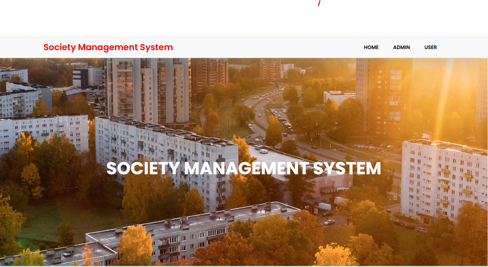
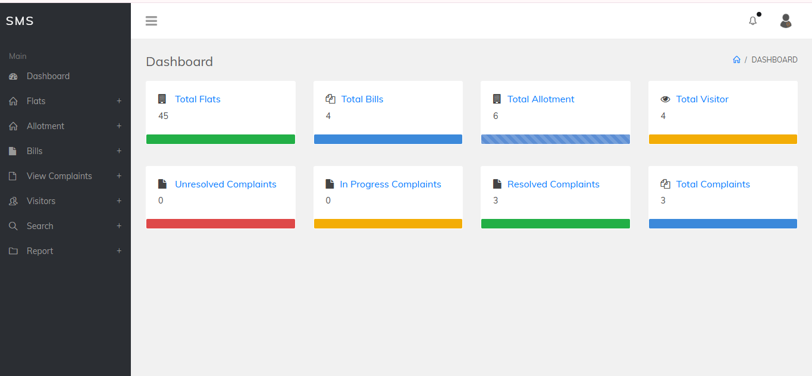
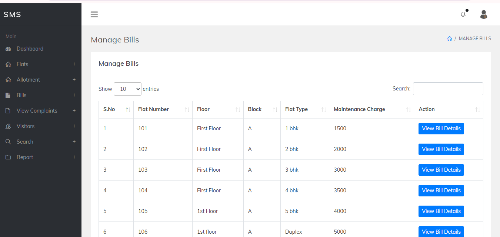
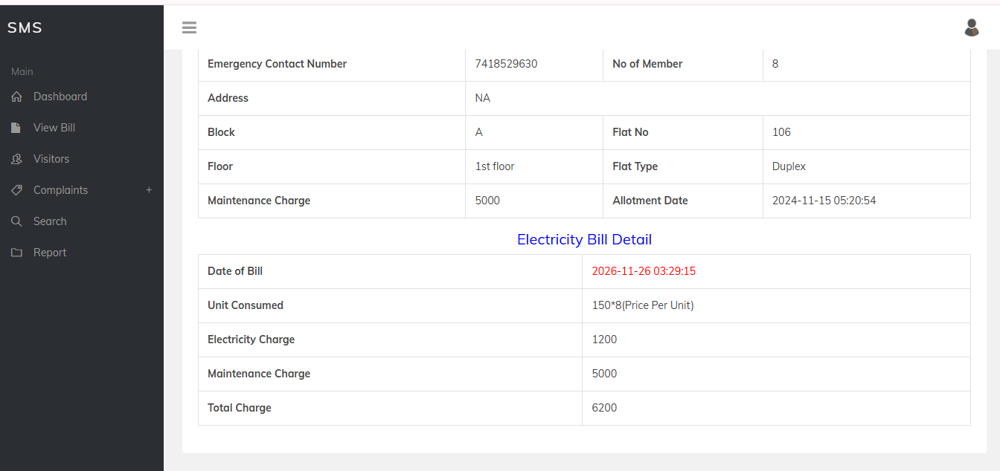

# Society Management System

A PHP and MySQL web app for managing a housing society, with separate Admin and Resident panels.

**Live demo:** https://mrudulasociety.infinityfreeapp.com/sms/

## Tech Stack
PHP, MySQL, HTML, CSS, JavaScript

## Demo logins
**Admin:** username `admin`, password `Admin@123`

**Resident:** mobile `8541236541`, block `A`, flat `106`

## Run locally (WAMP/XAMPP)
1. Copy the `sms` folder into `C:\wamp64\www\`
2. Create a database named `smsdb` in phpMyAdmin
3. Import `SQL File/smsdb.sql`
4. Open http://localhost/sms/

## Screenshots

## Credits
Based on an open-source Society Management System project: [original author and link].

My work: deployed it online, set up the MySQL database and hosting, and fixed the configuration.
